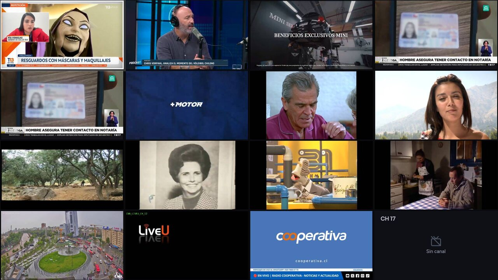
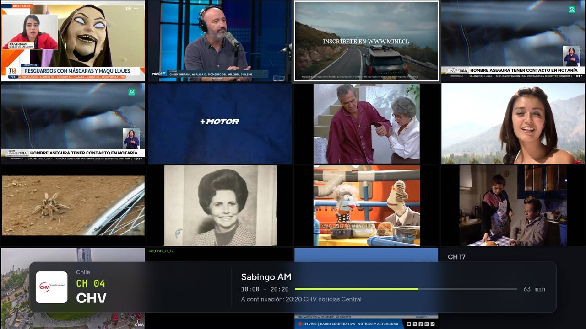
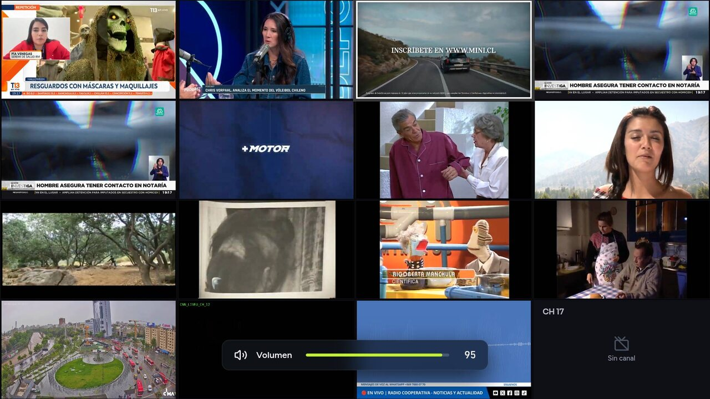
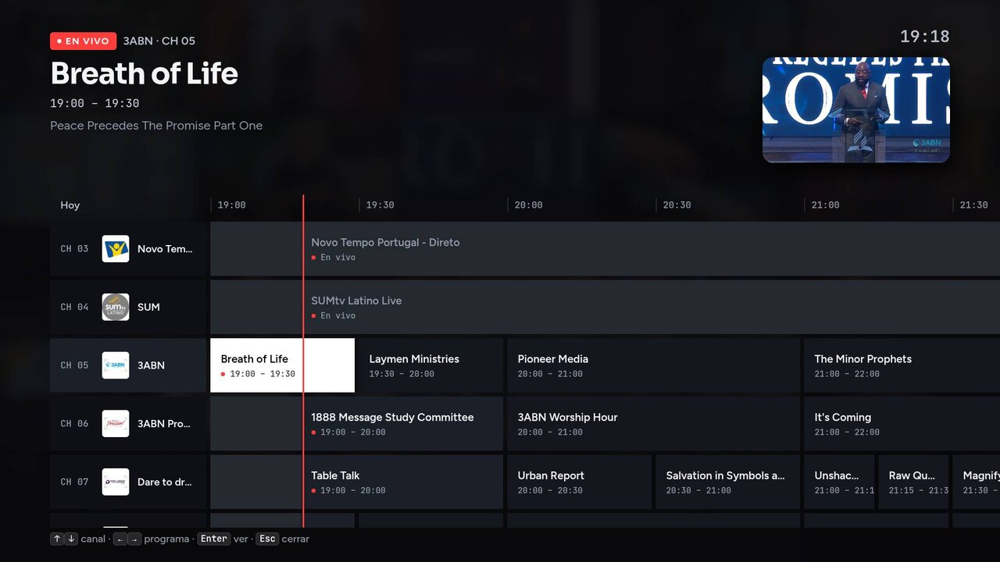
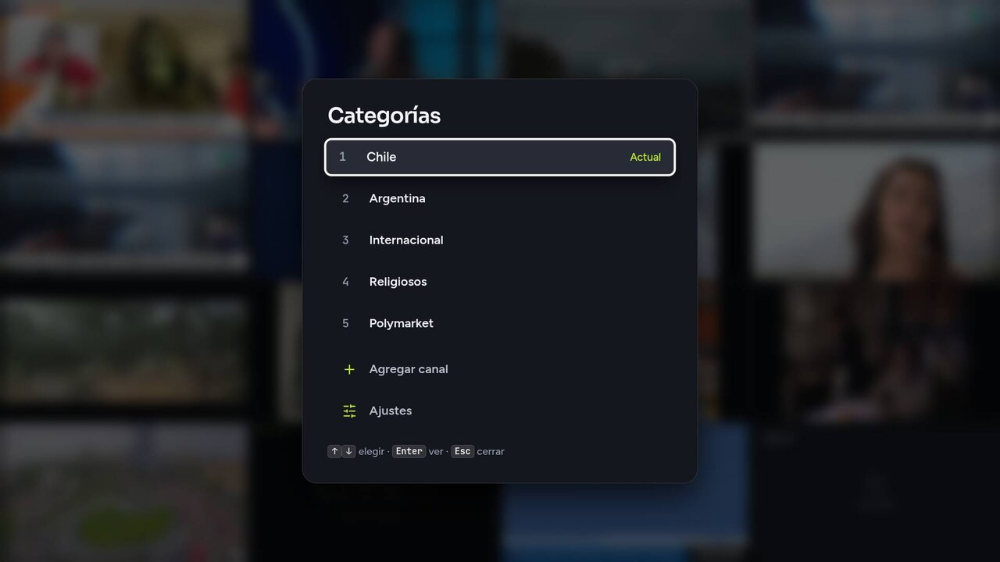
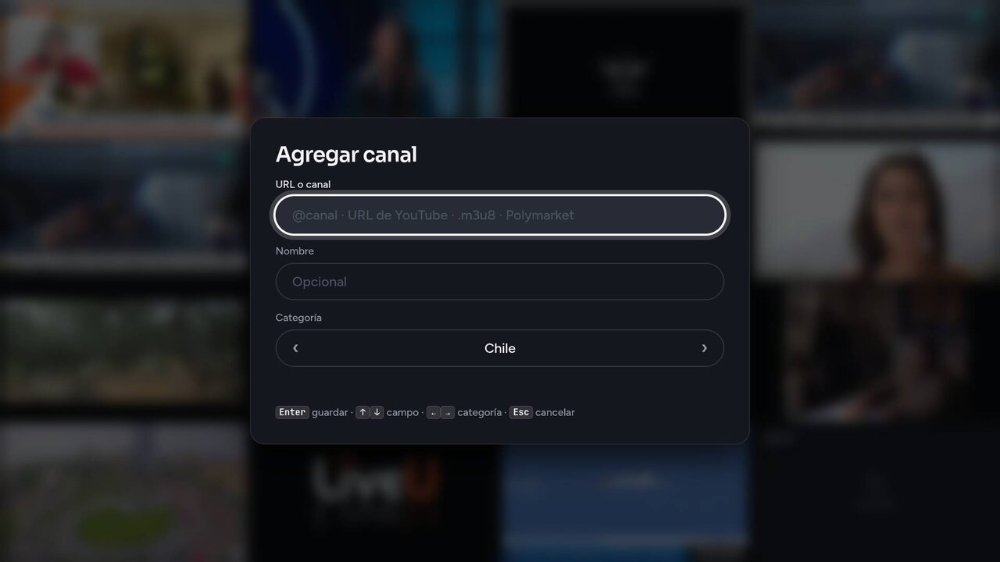
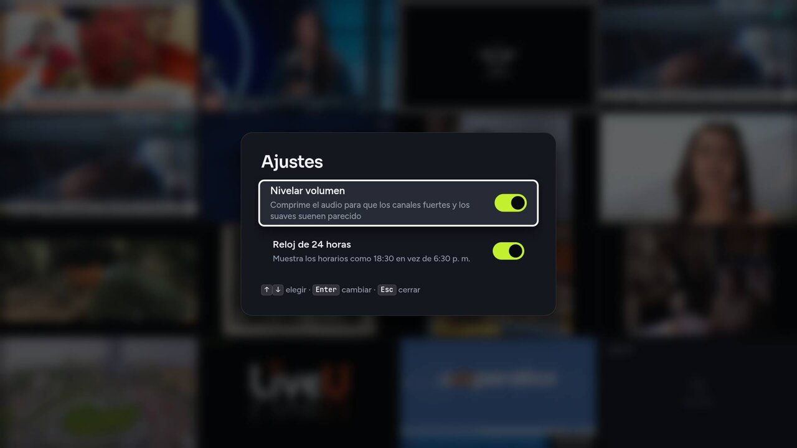
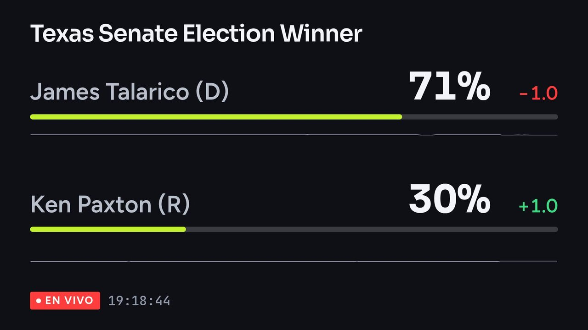
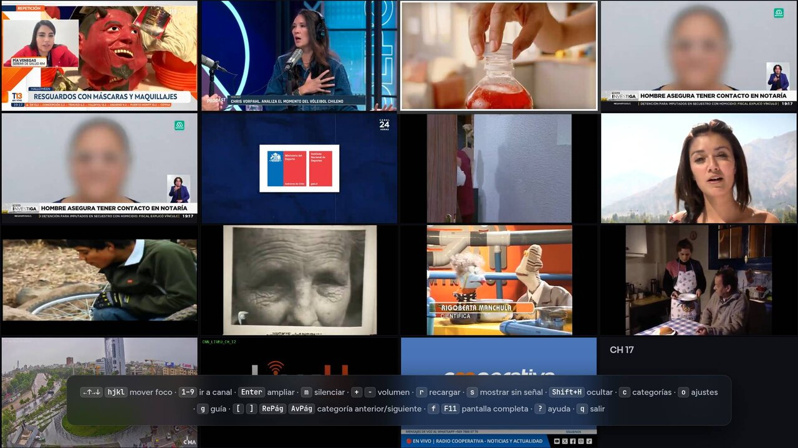

# LiveTV

**English** · [Español](README.es.md)

A mosaic of live channels (Electron): YouTube lives, HLS streams (`.m3u8`), Polymarket markets and Windy maps, with a program guide. It is driven with the keyboard like a TV; only the focused tile (white ring) plays audio. The user interface is in Spanish.



| Channel change | Volume |
|---|---|
|  |  |
| **Program guide** (`g`) | **Categories** (`c`) |
|  |  |
| **Add channel** | **Settings** (`o`) |
|  |  |
| **Polymarket** | **Help** (`?`) |
|  |  |

## Usage

```sh
npm install
npm start                      # or: npm start -- --config /path/streams.json
```

The config is looked up in `--config`, then `~/.config/livetv/streams.json`, then `./streams.json` (a minimal example config). To keep your own without touching the repo: `mkdir -p ~/.config/livetv && cp streams.json ~/.config/livetv/`. `streams-jc.json` is a complete example config (Chile, Argentina, international and religious channels): `npm start -- --config streams-jc.json`.

```json
{
  "columns": null,
  "categories": [
    { "name": "Noticias", "streams": [
      { "name": "DW News", "channel": "UCknLrEdhRCp1aegoMqRaCZg" },
      { "name": "Reservado" }
    ]},
    { "name": "Música", "columns": 1, "streams": [
      { "name": "Lofi Girl", "url": "https://www.youtube.com/watch?v=0sfDth4lMLc" }
    ]}
  ]
}
```

From the categories menu (`c`, then **Add channel** or `a`) you can **add a channel** (*Agregar canal*) without editing the file: type a handle (`@channel`), a YouTube channel or video URL, an `.m3u8` URL, a Polymarket event URL or a windy.com map URL, an optional name (if left empty, the YouTube or Polymarket title is used) and the category (←→); ↑↓ or Tab move between fields, Enter saves and Esc cancels. It is appended to that category in the config file (which is rewritten as standard JSON) and opens right away.

The mosaic shows one category at a time (the first one at startup); switching categories closes the previous one's streams. The same channel can appear in several categories. Instead of `categories` you can use a plain `"streams": [...]` list, which becomes a single category.

- `url`: `watch?v=`, `youtu.be/`, `/live/`, `/embed/` or the 11-character ID. It also accepts a direct HLS stream (`.m3u8` URL), played with hls.js; if it ends or fails, it is retried every 30 s.
- `channel`: channel ID (`UC…`), handle (`@name`) or channel URL; automatically follows the current live. If the channel streams several lives at once, each one gets its own tile (`CH 07`, `CH 07-2`, …), which closes when that live ends. New lives are detected every 2 minutes.
- `max`: optional, with `channel`; maximum number of tiles (simultaneous lives) for that channel.
- `epg`: optional; where to get the channel's schedule for the guide:
  - `mi.tv/<country>/<channel>`: [mi.tv](https://mi.tv), with the country and channel from its URL (the page `mi.tv/cl/canales/chilevision` is `"epg": "mi.tv/cl/chilevision"`).
  - `3abn/<channel>`: the [3ABN schedule](https://r.3abn.org/sched-app/#/); `<channel>` is `main`, `proc` (Proclaim), `dare` (Dare to Dream), `int` (International), `canada`, `praise` (Praise Him), `kids`, `lat` (Latino) or `radio`.

  Without `epg`, the guide shows the title of the live being streamed. Each source is a module in `epg/`; to add another one, create its module and add it to `SOURCES` in `epg/index.js`.
- `logo`: optional; URL of an image with the channel's logo for the channel banner and the guide (shown on a white plate). Without `logo`, the mi.tv logo is used if the channel has `epg`, otherwise the YouTube channel avatar.
- `polymarket`: slug or URL (`polymarket.com/event/<slug>`) of a Polymarket event. The tile has no video: it shows each outcome's probability, its daily change and a 24 h sparkline, updated live. Example: `{ "name": "Brasil 2ª vuelta", "polymarket": "brazil-presidential-election" }`.
- `outcomes`: optional, with `polymarket`; how many outcomes to show (4 by default, the most likely ones).
- `windy`: URL of a windy.com map (`https://www.windy.com/?wind,-33.45,-70.66,7`: layer, latitude, longitude and zoom, as shown in the address bar; with `/lat/lon` in the path, that point is marked and its forecast shown) or an `embed.windy.com` URL (Windy's "Embed" widget, with all its options). The tile has no audio and reloads every hour.
- Without `url`, `channel`, `polymarket` or `windy`: an empty "Sin canal" (no channel) tile.
- `columns`: optional, global or per category; defaults to `ceil(sqrt(N))`.

Channels with no signal (error, live ended, embedding disabled) leave the mosaic until they are back on air, so the grid doesn't jump with every retry; the `s` key shows them, with a dark screen and the reason. `channel` entries and ended lives are retried every 30 s. Entries without a channel and leftover grid cells show that same screen.

Audio is global, like on a TV: volume and mute apply to every channel. If the focused tile has no audio (Polymarket or Windy), the last focused video keeps playing. Clicking a tile also focuses it.

When you **change channels**, a banner appears at the bottom with the channel's logo (or initials), number and name and, on the right, the current program: with `epg`, its time slot, a progress bar, the minutes left and what's next; without `epg`, the live's title. It always keeps the same layout, so it can be read at a glance while channel surfing.

The **program guide** (`g`) has one row per channel in the category, with the schedule of those that have `epg`. The selected channel plays live in the preview box and the audio follows it; Enter tunes to it and enlarges it.

Logos and schedules are stored in `cache/` (ignored by git): logos are kept for 7 days and schedules for 30 minutes; if refreshing them fails, the stored copy is still used.

In **Settings** (`o`, *Ajustes*):

- **Volume leveler** (*Nivelar volumen*, on by default): compresses the audio so loud and quiet channels sound similar.
- **24-hour clock** (*Reloj de 24 horas*, on by default): when off, times in the banner, the guide and Polymarket are shown as `6:30 p. m.`.

Settings are saved in `~/.config/livetv/settings.json`.

## Keys

| Key | Action |
|---|---|
| ←↑→↓ / h j k l | move focus |
| 1–9 | go to channel N (`CH 0N`) |
| Enter / Space | enlarge/restore the focused tile |
| m | mute/unmute audio (global) |
| + / − | global volume, kept when changing channels (on-screen OSD; unmutes) |
| r | reload the focused stream (for a `channel`, also looks for its lives again) |
| s | show or hide channels with no signal |
| Shift+H | hide the focused stream and close its player (asks for confirmation: H/Enter yes, any other key no); it stays hidden in every category until the app restarts |
| c | categories menu: ↑↓ / j k select, Enter or 1–9 open, c / Esc close; at the end, **Add channel** (or `a`) and **Settings** (or `o`) |
| g | program guide: ↑↓ / j k channel, ←→ / h l program, Enter tunes in, g / Esc close |
| o | settings (volume leveler, 24-hour clock) |
| [ / ] · PgUp / PgDn | previous / next category |
| f / F11 | fullscreen |
| ? | help |
| Esc | close the enlarged tile or the help; if nothing is open, quit |
| q | quit |
