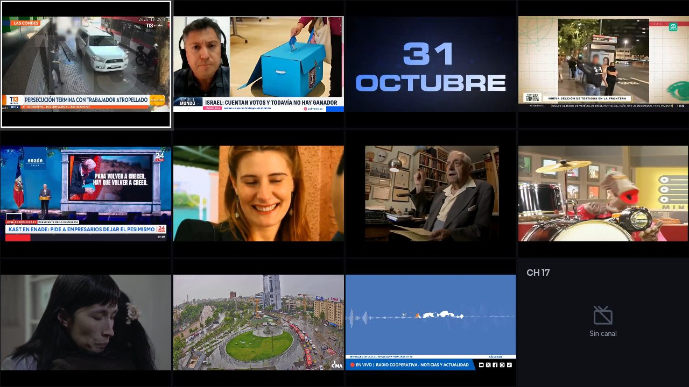
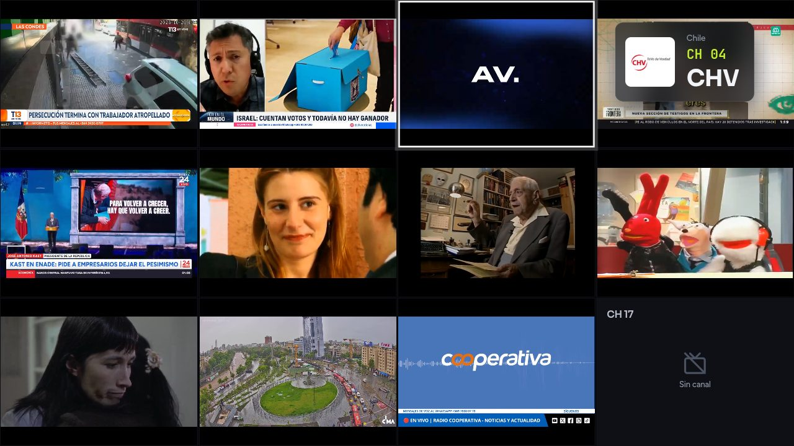
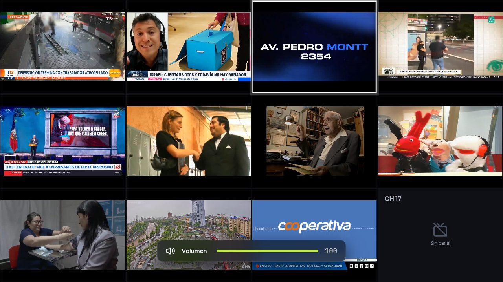
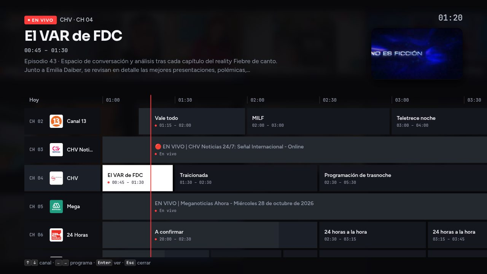
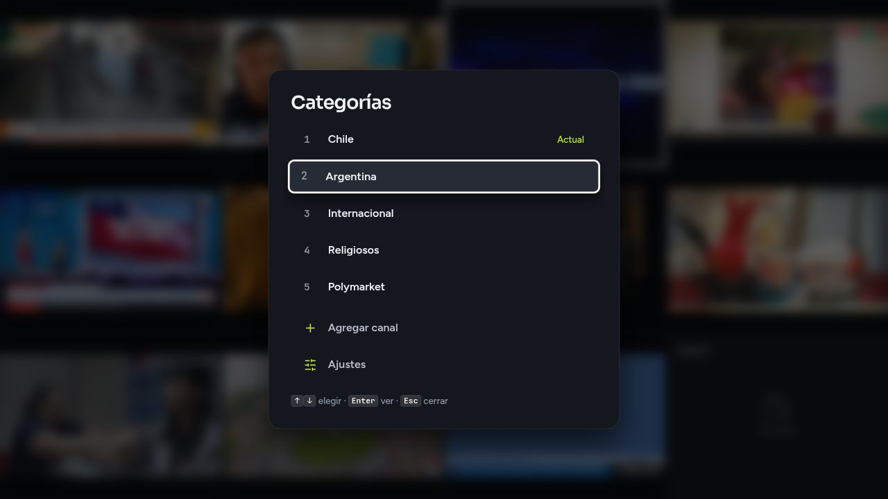
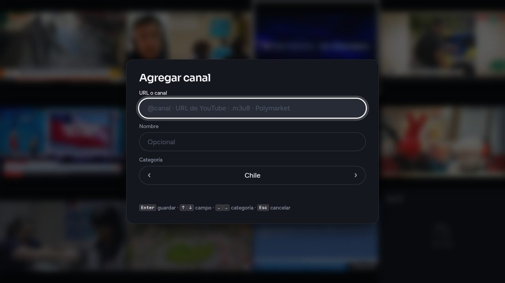
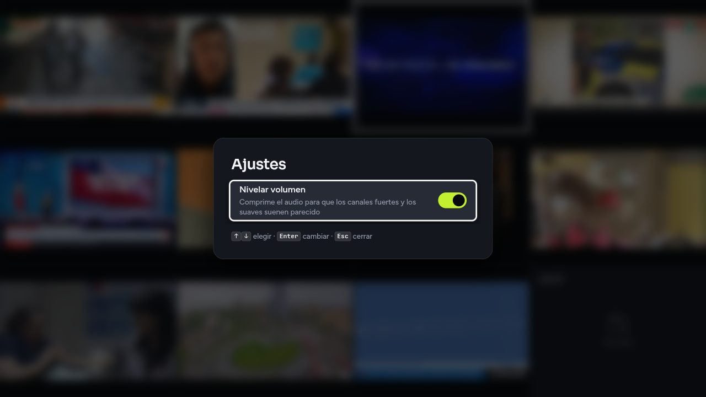
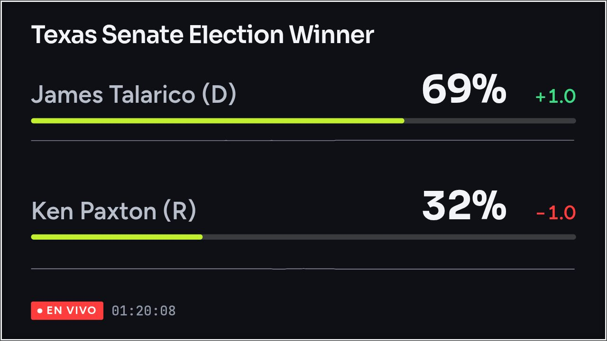
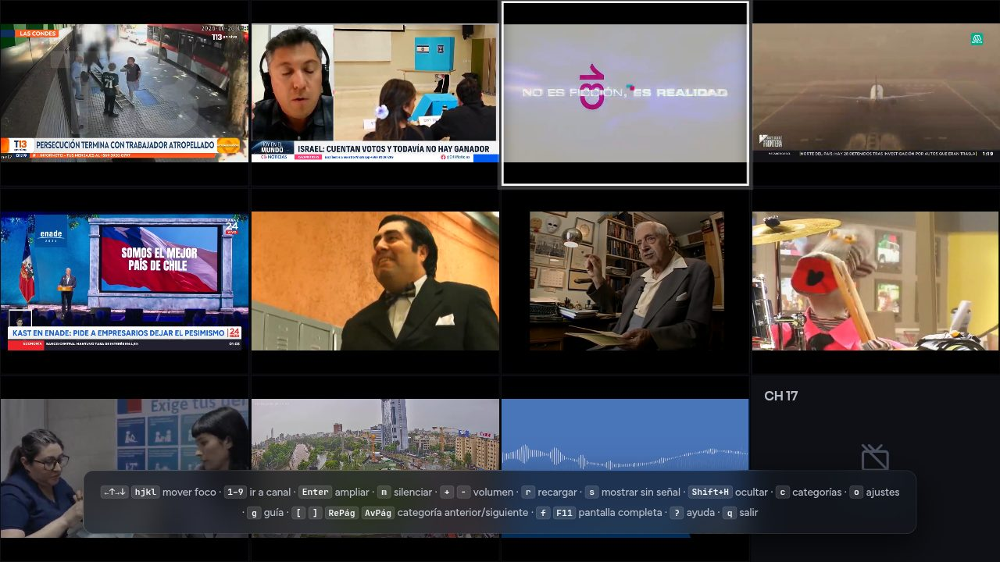

# LiveTV

Mosaico de streams en vivo de YouTube (Electron). Solo el tile con foco (anillo blanco) tiene audio.



| Cambio de canal | Volumen |
|---|---|
|  |  |
| **Guía de programación** (`g`) | **Categorías** (`c`) |
|  |  |
| **Agregar canal** | **Ajustes** (`o`) |
|  |  |
| **Polymarket** | **Ayuda** (`?`) |
|  |  |

## Uso

```sh
npm install
mkdir -p ~/.config/livetv && cp streams.example.json ~/.config/livetv/streams.json
npm start                      # o: npm start -- --config /ruta/streams.json
```

La config se busca en `--config`, luego `~/.config/livetv/streams.json`, luego `./streams.json`.

```json
{
  "columns": null,
  "categories": [
    { "name": "Noticias", "streams": [
      { "name": "DW News", "channel": "UCknLrEdhRCp1aegoMqRaCZg" },
      { "name": "Reservado" }
    ]},
    { "name": "Música", "columns": 1, "streams": [
      { "name": "Lofi Girl", "url": "https://www.youtube.com/watch?v=0sfDth4lMLc" }
    ]}
  ]
}
```

Desde el menú de categorías (`c`) se puede **agregar un canal** sin editar el archivo: se escribe un handle (`@canal`), una URL de canal o video de YouTube, una URL `.m3u8`, la de un evento de Polymarket o la de un mapa de windy.com, un nombre opcional (si queda vacío se usa el título de YouTube o Polymarket) y la categoría (←→). Se guarda al final de esa categoría en el archivo de config (que se reescribe con formato JSON estándar) y se abre en el acto.

El mosaico muestra una categoría a la vez (al empezar, la primera); al cambiar se cierran los streams de la anterior. Un mismo canal puede repetirse en varias categorías. En vez de `categories` se puede usar directamente una lista `"streams": [...]`, que queda como una sola categoría.

- `url`: `watch?v=`, `youtu.be/`, `/live/`, `/embed/` o el ID de 11 caracteres. También acepta un stream HLS directo (URL `.m3u8`), que se reproduce con hls.js; si termina o falla se reintenta cada 30 s.
- `channel`: ID del canal (`UC…`), handle (`@nombre`) o URL del canal; sigue automáticamente el live actual. Si el canal transmite varios lives a la vez, cada uno ocupa su propio tile (`CH 07`, `CH 07-2`, …), que se cierra cuando ese live termina. Los lives nuevos se detectan cada 2 minutos.
- `max`: opcional, con `channel`; tope de tiles (lives simultáneos) para ese canal.
- `epg`: opcional; programación del canal en [mi.tv](https://mi.tv) para la guía, como `mi.tv/<país>/<canal>` (la página `mi.tv/cl/canales/chilevision` es `"epg": "mi.tv/cl/chilevision"`). Sin `epg`, la guía muestra el título del live que se está transmitiendo.
- `polymarket`: slug o URL (`polymarket.com/event/<slug>`) de un evento de Polymarket. El tile no tiene video: muestra la probabilidad de cada outcome, su variación del día y un sparkline de 24 h, actualizados en vivo. Ejemplo: `{ "name": "Brasil 2ª vuelta", "polymarket": "brazil-presidential-election" }`.
- `outcomes`: opcional, con `polymarket`; cuántos outcomes mostrar (por defecto 4, los más probables).
- `windy`: URL de un mapa de windy.com (`https://www.windy.com/?wind,-33.45,-70.66,7`: capa, latitud, longitud y zoom, tal como queda en la barra de direcciones; con `/lat/lon` en el path se marca ese punto y se muestra su pronóstico) o una URL de `embed.windy.com` (el widget de "Embed" de Windy, con todas sus opciones). El tile no tiene audio y se recarga cada hora.
- Sin `url`, `channel`, `polymarket` ni `windy`: tile vacío "Sin canal".
- `columns`: opcional, global o por categoría; por defecto `ceil(sqrt(N))`.

Los canales sin señal (error, live terminado, embed deshabilitado) y las celdas vacías muestran una pantalla oscura con el motivo. Los `channel` y los lives terminados se reintentan cada 30 s.

La **guía de programación** (`g`) tiene una fila por canal de la categoría, con la programación de mi.tv para los que tienen `epg`. El canal elegido se ve en vivo en el recuadro y su audio lo sigue; Enter lo sintoniza y lo amplía.

El **nivelador de volumen** (encendido por defecto, se apaga en Ajustes con `o`) comprime el audio para que los canales fuertes y los suaves suenen parecido. Los ajustes se guardan en `~/.config/livetv/settings.json`.

## Teclas

| Tecla | Acción |
|---|---|
| ←↑→↓ / h j k l | mover foco |
| 1–9 | ir al canal N |
| Enter / Espacio | ampliar/restaurar el tile enfocado |
| m | silenciar/reactivar el audio (global) |
| + / − | volumen global, se mantiene al cambiar de canal (OSD en pantalla; quita el silencio) |
| r | recargar el stream enfocado |
| Shift+H | ocultar el stream enfocado y cerrar su reproductor (pide confirmación: H/Enter sí, otra tecla no); queda oculto en todas las categorías hasta reiniciar la app |
| c | menú de categorías: ↑↓ / j k elegir, Enter o 1–9 abrir, c / Esc cerrar; al final, **Agregar canal** (o `a`) y **Ajustes** |
| g | guía de programación: ↑↓ canal, ←→ programa, Enter sintoniza, g / Esc cerrar |
| o | ajustes (nivelador de volumen) |
| [ / ] · RePág / AvPág | categoría anterior / siguiente |
| f / F11 | pantalla completa |
| ? | ayuda |
| Esc | cerrar ampliación/ayuda, o salir |
| q | salir |
